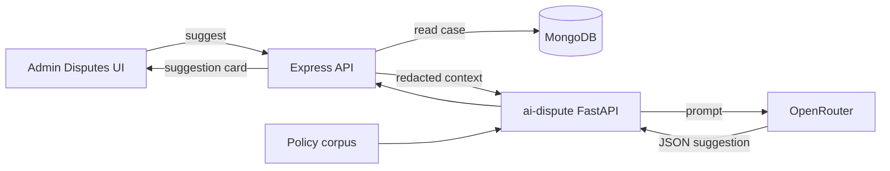
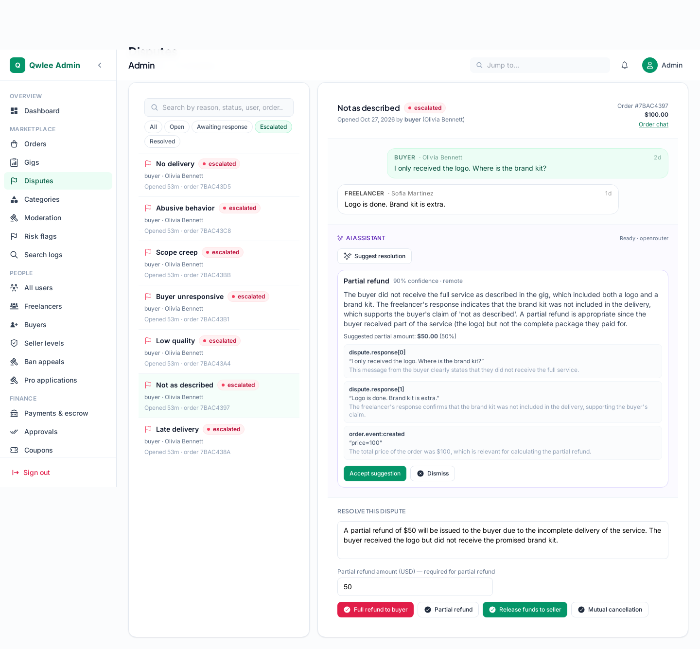
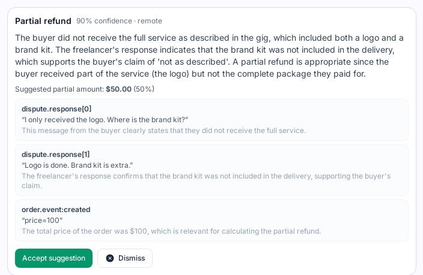
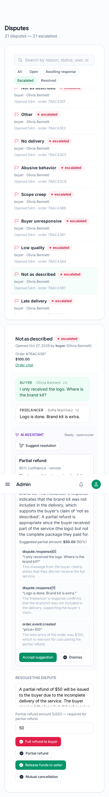

# Qwlee

An open-source, Fiverr-style freelance services marketplace: sellers publish gigs, buyers order them, both sides chat in real time, and admins manage everything from a dashboard.

| App | Stack | Port |
|---|---|---|
| `backend/` | Express 4, Mongoose 8, Socket.IO | 7171 (REST), 8181 (socket) |
| `frontend/` | Next.js 16, React 19, Redux Toolkit, Tailwind | 8000 |
| `admin/` | Vite 5, React 18 | 4000 |
| database | MongoDB 7 | internal |

Full feature list: [docs/FEATURES.md](docs/FEATURES.md). Architecture and developer guides: [docs/](docs/).

## Case study: AI Dispute Assistant

**Problem.** Admins resolving marketplace disputes had to dig through order chat, delivery events, and policy pages by hand. That was slow, easy to miss evidence, and hard to keep consistent with published refund rules.

**How it works.** On **Admin → Disputes**, an admin opens a case and clicks **Suggest resolution**. Express assembles a redacted context pack (dispute thread, order events, last ~80 order messages, gig package, top policy chunks) with PII masked. A small FastAPI sidecar (`services/ai-dispute`) calls OpenRouter, validates the JSON against a strict schema, and drops any citation that was not in the prompt. The admin sees outcome, confidence, evidence quotes, and an optional partial-refund amount — then must Accept, edit, copy an ask-more draft, or Dismiss. The model never refunds or releases escrow on its own.



**Eval.** Offline mock harness: **100%** exact outcome match on 20 seeded cases. Live OpenRouter (`openai/gpt-4o-mini`): **90%** (18/20). Misses E11 and E20 returned the safer `ask_for_more_info` instead of `release_to_seller`.

**Human approval.** Every suggestion is logged on `DisputeAiSuggestion` (model, latency, source). Accept runs the existing resolve endpoint only after the admin confirms. Ask-for-more is draft-only (copy/paste). Partial refunds carry a real amount field.

**Screenshots** (desktop suggestion card, evidence close-up, 375px):







Operational env vars and eval commands: [Admin Dispute AI assistant](#admin-dispute-ai-assistant) below.

## Case study: AI support inbox

Buyers and sellers can ask policy questions on **Help & support**. Express retrieves policy chunks, the FastAPI sidecar answers with citations, and anything under 55% confidence (or an explicit “talk to a human”) opens a `SupportTicket` tagged `aiEscalated` for the admin queue. Rate-limited (20/hour), PII-masked, mock mode when `AI_API_KEY` is unset.

## Case study: Smart NL gig search

Type something like “logo for my bakery under $50” and hit **Smart** on `/gig`. The AI parses category, price cap, and keywords; results show why each gig matched. If the AI is down, search falls back to ordinary title matching.

## Demo video

**qwlee – Full User Manual: Open-Source Freelance Marketplace (Buyer, Seller & Admin Walkthrough)**

[](https://youtu.be/m91b9sDshw0)

<details>
<summary>Chapters</summary>

- 0:00 Title
- 0:06 Intro and home page
- 0:45 Browsing, search and gig pages
- 2:18 Sign up and sign in
- 2:50 Buyer: ordering and checkout
- 3:14 Buyer: orders
- 4:18 Buyer: reviews
- 4:45 Buyer: messages
- 5:13 Buyer: wallet, history and lists
- 6:05 Seller: dashboard
- 6:22 Seller: creating a gig
- 6:48 Seller: levels and Success Score
- 7:33 Seller: analytics
- 7:43 Seller: orders and delivery
- 7:57 Seller: earnings and withdrawals
- 8:21 Seller: chat tools and growth
- 8:44 Policies
- 9:25 Admin: overview
- 9:44 Admin: users and sellers
- 10:11 Admin: gigs and moderation
- 10:54 Admin: orders and money
- 11:28 Admin: content and communication
- 11:57 Admin: settings and operations
- 12:45 Wrap-up

</details>

## Quick start (Docker)

Requires Docker with Compose v2.

```sh
git clone https://github.com/SahinurDEV/qwlee.git
cd qwlee
cp .env.example .env          # set JWT_SECRET (openssl rand -hex 64)
docker compose up --build
```

Then open:

- Marketplace: http://localhost:8000
- Admin dashboard: http://localhost:4000
- API: http://localhost:7171 (health: `/health`; Swagger docs at `/v1/docs` when `ENABLE_API_DOCS=true`)
- Mailpit (every email the app sends, e.g. verification and reset codes): http://localhost:8025

Load demo data (in another terminal):

```sh
docker compose exec backend npm run seed
```

With the default `SEED_DEMO_IF_EMPTY=true`, the API loads this demo data by itself the first time it starts against an empty database (a fresh install, or a lost Docker volume). It never touches a database that already has users. Set `SEED_DEMO_IF_EMPTY=false` in production; the API then only logs a warning when it finds no users.

Demo logins after seeding: `admin@example.com / Admin123!`, `seller@example.com / Seller123!`, `buyer@example.com / Buyer123!`.

Seed images are committed under `backend/public/seed/` and served by the API at `/seed/...`, so demo data never depends on an external image host. Seeded image URLs use `PUBLIC_API_URL`; re-run the seed if you change it.

MongoDB data persists in the `mongo-data` volume. `docker compose down -v` wipes it.

## Configuration

All Docker config lives in the root `.env` (see [.env.example](.env.example)).

| Variable | Required | Purpose |
|---|---|---|
| `JWT_SECRET` | yes | Signs/verifies auth tokens (backend + frontend middleware) |
| `PUBLIC_API_URL`, `PUBLIC_SOCKET_URL` | no | URLs the browser uses to reach the API; baked in at build time, so rebuild after changing |
| `FRONTEND_URL`, `CORS_ORIGINS` | no | Redirect target and allowed origins |
| `*_PORT` | no | Host ports |
| `IMGBB_API_KEY` | optional | Store uploads on ImgBB; without it they go to the local `uploads` volume |
| `STRIPE_*` | for payments | Use test keys locally |
| `SMTP_*`, `EMAIL_FROM` | for email | OTP and password-reset email |
| `ENABLE_API_DOCS` | no | Serve Swagger UI at `/v1/docs` outside development |
| `PLATFORM_FEE_PERCENT` | no | Commission on completed orders (default 5). Admin can override in Settings > Misc with key `platformFeePercent` |
| `DEMO_PAYMENTS` | no | When no `STRIPE_SECRET_KEY` is set, place orders without charging (default `true` in compose). **Set to `false` in production.** |
| `AUTO_COMPLETE_DAYS` | no | Days after a delivery before the order auto-completes and escrow is released (default 3) |
| `REQUEST_TTL_DAYS` | no | Days a buyer request stays open for offers (default 14) |
| `ORDER_HOUSEKEEPING_MS` | no | Interval of the auto-complete / late-marking job (default 600000) |
| `CANCEL_RESPONSE_HOURS` | no | Hours the other party has to answer a mutual cancellation request before it is auto-accepted (default 48) |
| `PROMO_DAY_PRICE` | no | Price per day, in dollars, for promoting a gig (default 5) |
| `FX_RATES_URL` | no | USD exchange-rate JSON with a `rates` object (for example `https://open.er-api.com/v6/latest/USD`), refreshed every 12 hours. Without it, a built-in approximate table is used |
| `CURRENCIES` | no | Display currencies offered, comma-separated, from USD, EUR, GBP, BDT, INR, AUD, CAD, JPY (default: all) |
| `PAYPAL_CLIENT_ID` / `PAYPAL_CLIENT_SECRET` | no | Send PayPal withdrawals with the PayPal Payouts API. Without them PayPal payouts run in demo mode |
| `PAYPAL_ENV` | no | `sandbox` (default) or `live` |
| `PAYONEER_API_TOKEN` / `PAYONEER_PROGRAM_ID` | no | Send Payoneer withdrawals with the Payoneer Mass Payout API. Without them Payoneer payouts run in demo mode |
| `PAYONEER_API_URL` | no | Payoneer API base (default `https://api.sandbox.payoneer.com`) |
| `GOOGLE_CLIENT_ID`, `GOOGLE_CLIENT_SECRET`, `GOOGLE_REDIRECT_URI` | optional | Google sign-in (see below) |
| `UPLOAD_DIR`, `PRIVATE_UPLOAD_DIR` | no | Local upload folder (default `backend/uploads`) and the non-public folder for ID documents (default `<UPLOAD_DIR>/.private`) |
| `SECOND_APPROVAL_OVER` | no | Initial value of the admin setting: refunds/payouts above this amount need a second admin (0 = off) |
| `VAPID_PUBLIC_KEY`, `VAPID_PRIVATE_KEY`, `VAPID_SUBJECT`, `PUSH_ENDPOINT_HOSTS` | optional | Browser push notifications (see Notifications) |
| `AUTH_RATE_LIMIT_MAX` | no | Failed `/v1/auth` requests allowed per IP per 15 minutes (default 20). The test suite runs with a higher value |
| `GEOIP_URL` | no | IP-to-country lookup used for the buyer's country (default `https://ipapi.co/{ip}/json/`; empty disables it) |

Other payment providers and SMTP can also be configured from the admin panel.

### Email

Out of the box all email goes to the bundled Mailpit inbox at http://localhost:8025, so sign-up verification and password reset work without a real mail server. To send real email set `SMTP_HOST`, `SMTP_PORT`, `SMTP_USERNAME`, `SMTP_PASSWORD` and `EMAIL_FROM` in `.env` (or in the admin panel). If sending fails, password reset returns an error instead of pretending it worked.

### Payments with Stripe (test mode)

1. Create a free Stripe account and copy the **test** keys from https://dashboard.stripe.com/test/apikeys into `.env` as `STRIPE_SECRET_KEY` (`sk_test_...`) and `STRIPE_PUBLISHABLE_KEY` (`pk_test_...`).
2. Install the [Stripe CLI](https://stripe.com/docs/stripe-cli) and forward webhooks: `stripe listen --forward-to localhost:7171/v1/orders/webhook`. Put the printed `whsec_...` value in `STRIPE_WEBHOOK_SECRET`.
3. `docker compose up -d --build backend`, then pay with card `4242 4242 4242 4242`, any future date and any CVC.

## Google sign-in (optional)

The "Continue with Google" button on sign-in and sign-up only appears when the backend has `GOOGLE_CLIENT_ID` and `GOOGLE_CLIENT_SECRET`.

1. In Google Cloud Console, create an OAuth client ID of type *Web application*.
2. Add the authorised redirect URI `<PUBLIC_API_URL>/v1/auth/google/callback`, for example `http://localhost:7171/v1/auth/google/callback`. To use a different URI, set `GOOGLE_REDIRECT_URI`.
3. Put both values in `.env` and run `docker compose up -d`.

New Google users become buyers with a verified email. If an account with the same email already exists, it is linked. If that account had never verified its email, its password is removed so that only the real owner can get in. A new Google user who arrived through a referral link (`?ref=`) gets the referral coupon, just like a form sign-up. Tokens never appear in URLs: the callback hands the frontend a two-minute, single-use code, which it exchanges at `POST /v1/auth/google/exchange`.

## Two-factor sign-in

Any user can turn on two-factor sign-in (TOTP: Google Authenticator, 1Password, Authy…) under Profile → Edit. It gives 8 single-use recovery codes. After that, password sign-in asks for a code. Google sign-in returns a short-lived challenge, which `POST /v1/auth/2fa/verify` exchanges for tokens with the code. Admins manage theirs in the admin panel (Security), where a super admin can also require 2FA for all admins.

## Notifications

In-app notifications are always kept. At `/notifications/settings` each user chooses, per category (orders, messages, reviews, requests, payments, news), whether they also get an email and a browser notification. Sign-in codes, password resets, payment and payout emails, and account notices are always emailed.

Browser (Web Push) notifications need a VAPID key pair in `.env`:

```
docker compose exec backend npx web-push generate-vapid-keys
# then set VAPID_PUBLIC_KEY, VAPID_PRIVATE_KEY, VAPID_SUBJECT=mailto:you@example.com
```

Without keys the "Browser notifications" switch says they aren't set up, and pushes are only logged (`[push:demo]`). For safety, the server only sends to the browser push services (Chrome/FCM, Firefox, Apple, Microsoft). Override this with `PUSH_ENDPOINT_HOSTS`. Push needs HTTPS, or `localhost`, and the site's own `/sw.js` service worker. Tunnels with an interstitial page, such as ngrok's free plan, break service worker registration because `/sw.js` comes back as HTML.

## Admin site settings

These live in the database and are edited in the admin panel (Site settings). They are read through `GET /v1/info/site` (public part only).

| Setting | Default | Purpose |
|---|---|---|
| `features.signups`, `features.buyerRequests`, `features.tips`, `features.googleLogin` | on | Switch features off without a deploy |
| `growth.referrals` | on | Referral programme (`/referrals` page, `GET /v1/growth/referrals/me`) |
| `growth.refereePercent` | 10 | % off the invitee's first order (single-use coupon, max $100, 90 days). Applied for form and Google sign-ups that came through a `?ref=` link |
| `growth.referrerReward` | 10 | Fixed $ coupon given to the inviter when the invitee's first order completes |

Coupons are managed under Coupons in the admin panel (finance role). The platform funds the discount: the seller is paid, and the fee charged, on the full price; refunds return what the buyer paid.


### Homepage builder

Admin → Site settings → **Homepage layout**: the hero always comes first; the
sections under it (stats, recently viewed, recommended, categories,
freelancers, why us, testimonials, join, blog) can be reordered and hidden,
and up to 5 custom text blocks (title, text, optional button with an
http(s) URL or /path, light/brand/dark style) can be placed anywhere among
them. The homepage reads the layout on the server (`/v1/info/site`, cached
60 s), so changes are live within a minute and the first paint is already in
the saved order. Unknown or duplicate keys are dropped; sections missing from
a saved layout are appended, so new sections show up by default.

## Order lifecycle

1. Buyer checks out a gig package (+ optional extras) or a custom offer. Prices are always computed on the server (`POST /v1/orders/quote` previews them).
2. Payment (Stripe, or demo mode) is held in **escrow** on the order.
3. If the gig has requirement questions, the buyer answers them; the delivery clock starts then.
4. Seller delivers; buyer accepts or requests a revision (limited by the package).
5. On acceptance, or `AUTO_COMPLETE_DAYS` after delivery, escrow is released to the seller minus the platform fee. Cancellations and dispute refunds return escrow to the buyer. A seller can cancel at any time and a buyer can cancel a late order; otherwise the buyer sends a cancellation request that the seller accepts or declines (auto-accepted after `CANCEL_RESPONSE_HOURS`).

### Promoted gigs

Sellers can promote an active gig from the Promote link in their gig table, or at `/promotions`. Each day costs `PROMO_DAY_PRICE` and is paid from the seller's balance up front. Buying again for the same gig extends the promotion. On page 1 of a marketplace search, up to two promoted gigs that match the search are shown in a "Sponsored" row above the results, with the slot rotating among them. Sponsored impressions and clicks are counted for each promotion. If a seller stops a promotion early, whole unused days go back to their balance. The demo seller (`seller@example.com`) is seeded with a $250 balance.

Categories have one level of subcategories (`GET /v1/categories` lists top-level; `?parentId=<id>` lists one parent's subcategories; `?level=all` lists both). Admins manage them on the Categories page. The marketplace can be filtered by subcategory (`/gig?subCategory=<id>`) and delivery time (`delivery=<days>`).

Gigs support extras, FAQ, requirement questions and an optional YouTube/Vimeo/MP4 video.

### Display currency

Every price is stored and charged in US dollars. Visitors can choose a display currency in the footer. The choice is saved in the browser, and prices on gig cards and gig pages are then shown converted and marked "≈", with the USD amount in the tooltip. The checkout review shows the USD charge with the converted amount underneath. Rates come from `GET /v1/info/currencies`.

### Payouts

Sellers withdraw to a bank account, PayPal (by email) or Payoneer (by payee id). Bank transfers are paid manually by the finance team, as before. When finance approves a PayPal or Payoneer withdrawal, the payout is sent to the provider straight away. The withdrawal id is used as the provider reference, so a retry can't pay twice. If the provider refuses, the withdrawal goes back to Pending with the error shown, so finance can retry or decline it. Without credentials, the payout is recorded as `demo` and nothing is sent. `GET /v1/withdrawal/methods` shows which methods are live.

On Admin → Withdrawals, finance can work through payouts in bulk:
- **Batch approve:** tick pending rows and choose "Approve selected" (`POST /v1/withdrawal/batch/approve`, up to 100 ids). Each one goes through the normal approval. Amounts at or above the "second approval over" setting are skipped and must be approved on their own.
- **Bank export:** `GET /v1/withdrawal/export/bank.csv` lists pending bank withdrawals for the bank's bulk upload (reference, name, email, bank, account, amount). Cells that would start a spreadsheet formula are escaped.
- **Reconcile:** upload the bank's statement (`POST /v1/withdrawal/reconcile` with `{csv, dryRun}`). It needs the columns `reference` (the withdrawal id) and `amount`, and optionally `status` (paid/failed) and `bank_reference`. Paid rows with the right amount are approved if still pending and stamped with the bank reference and `reconciledAt`. Unknown references, amount differences, failed rows and rows already reconciled are listed and left alone. Preview first, then apply.

Not verified against the real providers: the PayPal and Payoneer request formats follow their public API docs and are covered by stubbed tests, but no sandbox account has been used.

### Subscriptions

Sellers can offer monthly subscriptions on an active gig, with an optional discount of up to 30%. They set this on `/subscriptions`. On the gig page, a buyer can then use "Subscribe monthly" on a package. The first month is ordered straight away, and after that a normal order is created each month by the order housekeeping job, so escrow, delivery and payout work as for any order. The buyer can pause or resume a subscription, and either side can cancel it. A month that can't be ordered (for example, the seller is away or the gig was removed) is recorded as failed and retried the next month. Super admins can run billing now with `POST /v1/admin/jobs/subscriptions` (optional `asOf`).

Limitation: recurring card billing (Stripe Billing or off-session charges) is not implemented. Subscriptions only work while demo payments are on; otherwise the API answers 503.

### Milestone payments

A custom offer sent in chat can be split into 2 to 6 milestones. Each milestone has a title, an amount (at least $5) and a number of days, and the milestone amounts must add up to the offer price. The buyer pays the full price into escrow at checkout. On the order page, the buyer releases each milestone as the work arrives, and the seller is paid that share minus the platform fee. Releasing the last milestone, accepting the delivery, or auto-completion releases whatever is still held. Cancelling refunds only the part that hasn't been released (`POST /v1/orders/:id/milestones/:index/release`).

### Buyer requests

Buyers post a request (`/requests/new`) with a budget and deadline. Sellers browse open requests (`/requests`) and send one offer each (price, days, revisions, message). The buyer sees every offer and can decline it or hire. Hiring goes through the same server-priced escrow checkout (`POST /v1/orders/checkout {requestOfferId}`). It accepts that offer, declines the others and marks the request hired. Requests expire after `REQUEST_TTL_DAYS` (default 14).

After upgrading an existing database run `docker compose exec backend npm run migrate` (idempotent).

## Custom admin roles

Besides the built-in admin roles (super, moderator, support and finance), a super admin can create roles under Admin team → Custom roles (`GET/POST/PATCH/DELETE /v1/admin/roles`) and assign them from Users → Manage.

- **Permissions:** a role can hold any mix of `read`, `users.moderate`, `gigs.write`, `orders.write`, `finance`, `disputes`, `moderation`, `content`, `support`, `broadcast`, `analytics` and `settings`. Full access (`*`) stays with super, and `read` is always included.
- **Changing a role:** its admins are signed out, so the new rights apply when they sign in again.
- **Deleting a role:** a role that admins still hold can't be deleted. An admin whose role no longer exists gets no access rather than falling back to super.

## Bans, appeals and bulk actions

- **Temporary bans:** admins can ban for 1–365 days, or permanently, from Users → Manage → Ban (`PATCH /v1/admin/users/:id/ban {reason, days}`). A temporary ban lifts itself when it runs out, either at the user's next sign-in or in the background housekeeping run.
- **Appeals:** a banned user who tries to sign in sees the reason and the end date. The refused sign-in returns a 30-minute appeal token, so they can appeal right there without sending their password again (`POST /v1/auth/appeal {appealToken, message}`). They can have one open appeal at a time.
- **Reviewing appeals:** moderators handle them under People → Ban appeals (`GET /v1/admin/appeals`, `PATCH /v1/admin/appeals/:id {decision: accepted|rejected, reply}`). Accepting lifts the ban, and the user is emailed either way.
- **Bulk users:** tick rows on Users to ban, unban or sign several accounts out at once (`POST /v1/admin/bulk/users`, up to 200). Admin accounts and yourself are skipped.
- **Bulk gigs:** tick rows on Gigs to approve, request changes, pause, deny, feature or unfeature several gigs (`POST /v1/admin/bulk/gigs`). The note is shown to each seller on their dashboard. Each seller whose gig actually changes also gets an "Update on your gig" email with the note (template editable in Admin → Email templates).

## Announcements

Admin → Announcements sends an in-app notification, optionally by email too, now or at a set time.
- **Targeting:** narrow the audience (everyone, buyers or sellers) by location text, sign-up age, recent activity, ID verification, and whether the buyer has ever ordered. The form shows how many users match as you go (`POST /v1/admin/broadcast/preview`).
- **Scheduling:** set "Send at" to schedule the announcement. The background job sends it when due, to whoever matches at that moment, and claims each one first so it is sent only once. Until then you can edit it (`PATCH /v1/admin/broadcast/:id`) or cancel it (`POST /v1/admin/broadcast/:id/cancel`).
- **Manual run:** a super admin can run the job by hand with `POST /v1/admin/jobs/announcements {asOf}`.

## Keyword filters and risk flags

Admin → Site settings → "Keyword filters & risk rules" holds the rules:
- **Blocked words:** messages, custom offers, gigs, buyer requests and request offers containing one are refused with a 400.
- **Flagged words:** the text is accepted, but a risk flag is opened for review.

Words match whole words in any case, and phrases may span spaces or line breaks. A word inside a longer word (for example `scam` in `scampi`) doesn't match.

Other rules also open flags:
- With "flag contact info" on (the default), emails, phone numbers and messenger links (WhatsApp, Telegram, Skype and so on) in messages, offers and requests open a flag.
- Orders are flagged when an account younger than 3 days places one at or above the set amount (default $500, 0 turns it off), or when a buyer places 3 or more orders within an hour.

Moderators work the queue under Moderation → Risk flags (`GET /v1/admin/risk-flags?status=&kind=`, `PATCH /v1/admin/risk-flags/:id {status: open|dismissed|actioned, note}`). Changing the rules needs the settings permission.

## Manual setup (without Docker)

Prerequisites: Node.js 20.9+ and MongoDB on `localhost:27017`.

```sh
cd backend  && cp .env.example .env && npm install && npm run dev
cd frontend && cp .env.example .env && npm install && npm run dev
cd admin    && cp .env.example .env && npm install && npm run dev
cd backend  && npm run seed   # optional demo data
```

`JWT_SECRET` must match in `backend/.env` and `frontend/.env`. See [docs/CONTRIBUTING.md](docs/CONTRIBUTING.md) and [docs/TROUBLESHOOTING.md](docs/TROUBLESHOOTING.md).

## Tests

```sh
scripts/test-isolated.sh
```

This starts a separate, throw-away stack (`docker-compose.test.yml`, project `qwlee-test`) with its own in-memory database, mail catcher and ports (API on 17171), seeds it, runs the API tests and removes it. Your live or demo database is never touched. `KEEP=1` leaves the test stack running.

The tests refuse to run unless the API's `/health` reports `testMode: true` (set `TEST_MODE=true` on the backend, as the test stack and CI do), so `npm test` cannot write into a real database by accident. Set `ALLOW_NON_TEST_API=true` only if you really mean to.

## Contributing

Contributions are welcome. Read [CONTRIBUTING.md](CONTRIBUTING.md) and our [Code of Conduct](CODE_OF_CONDUCT.md). Report vulnerabilities privately as described in [SECURITY.md](SECURITY.md).

## License

[MIT](LICENSE)

### Support canned replies

In Admin → Support, the reply box has a canned-reply picker: insert a saved
reply (`{name}` becomes the ticket owner's first name), save the current text
as a new one, or delete the selected one. Any admin can read them; creating
or deleting needs the `support` permission. API: `GET/POST
/v1/admin/support/canned`, `PATCH/DELETE /v1/admin/support/canned/:id`.

### Funnels, cohorts and the weekly KPI email

Admin → Analytics also shows buyer and seller funnels for sign-ups in the
selected window (signed up → ordered → completed; signed up → active gig →
first sale), a monthly buyer cohort table (share of each month's new buyers
who ordered in month 0, 1, 2…), and a 7-day vs previous-7-day summary.
Housekeeping emails that summary to super admins every Monday (UTC), once per
ISO week (`KpiReport` has a unique week). A super admin can send it now with
"Send now" (`POST /v1/admin/jobs/kpi-email`). API: `GET
/v1/admin/kpi/funnel?days=`, `/kpi/cohorts?months=`, `/kpi/weekly`.

### Background job monitor

Every housekeeping step (auto-complete, late orders, cancellations,
subscription billing, scheduled announcements, ban expiry, weekly KPI email)
is timed and recorded in `JobRun` (kept 14 days). A failing step is logged
and recorded without stopping the others. Admin → Background jobs shows each
step's health (ok / failing / stale = no run for 3 intervals / never), last
run, runs and failures in the last 24 h, the last error and recent history;
super admins can "Run housekeeping now". API: `GET /v1/admin/jobs/status`,
`GET /v1/admin/jobs/history?job=&limit=`, `POST /v1/admin/jobs/housekeeping`.

### Maintenance mode

Admin → Site settings → **Maintenance mode** (message, optional "expected
back" time). While on, every marketplace page shows a maintenance screen
(within a minute; the layout caches site settings for 60 s) and the API
answers `503` with `MAINTENANCE: <message>` and `Retry-After` for everything
except `/v1/info`, `/v1/auth`, `/v1/admin` and `/v1/docs`, unless the request
carries an admin's access token. The admin dashboard keeps working. Chat pauses too: the
socket server refuses new non-admin connections (`connect_error`
`MAINTENANCE`) and answers events from already-connected users with a
`maintenance` event instead of handling them. Admin sockets keep working.

### Personal data: export and account deletion (GDPR)

- **Users**: Profile → Edit → *Your data*: "Download my data" (JSON of the
  profile and everything linked to it: gigs, orders, reviews, messages,
  requests, offers, withdrawals, notifications, tickets, favourites,
  portfolio, subscriptions, activity, sessions, saved replies, appeals; no
  password hashes, 2FA secrets or session token hashes). "Delete my account"
  needs the password (not for Google sign-in) and typing DELETE.
  API: `GET /v1/users/me/export`, `GET /v1/users/me/delete-check`,
  `POST /v1/users/me/delete` `{password, confirm: "DELETE"}`. The old
  `POST /v1/auth/delete-me` now does the same erasure.
- **Super admins**: Users → Manage → *Personal data*: export, or erase
  (`GET /v1/admin/privacy/:id/export`, `POST /v1/admin/privacy/:id/erase`
  `{confirm: "ERASE"}`; audited).
- **Erasure anonymises** rather than removes the account (orders, payments,
  messages and reviews are kept for the other party and accounting, shown as
  "Deleted user"): profile fields cleared, email/username replaced, sign-in
  disabled and every session revoked, gigs paused, active subscriptions
  cancelled; sessions, tokens, push subscriptions, saved replies, favourites,
  notifications, activity, portfolio and open buyer requests are deleted.
  It is refused while the user has open orders, pending withdrawals or a
  balance, and for admin accounts. Text and attachments of the chat and
  order messages they sent are replaced with "[message deleted]" (the other
  side keeps the thread), and their locally stored files (avatar, cover,
  portfolio, message attachments, verification documents in private
  storage) are deleted from the uploads volume. Files on ImgBB/Cloudinary
  can't be removed from the app and need the provider's dashboard.

### Backups

The `backup` compose service (mongo:7 running `scripts/backup.sh`) writes a
gzipped `mongodump` archive to the `backups` volume every
`BACKUP_INTERVAL_HOURS` (24) and keeps the newest `BACKUP_KEEP` (7). Each run
writes `status.json`. Admin → **Backups** (settings permission) shows health
(ok / failing / stale = overdue by 2 h / never), the last run, the kept
archives and a restore guide; super admins can "Back up now" (picked up
within 30 s). One-off backup: `docker compose run --rm backup once`.

Restore (replaces current data; turn on maintenance mode first):

```sh
docker compose exec backup sh -c 'mongorestore --uri="$MONGODB_URL" --gzip --drop --nsInclude "qwlee.*" --archive=/backups/<archive>'
docker compose restart backend
```

Each run also archives the `uploads` volume (`qwlee-<time>.uploads.tar.gz`)
and copies both files to an off-server folder: `BACKUP_OFFSITE_PATH` in
`.env` (default `./offsite-backups` next to the compose file, outside Docker's
volumes, so it survives a Docker reset). Point it at another disk, an NFS
mount or a synced folder (rclone, Dropbox, S3 mount) for real disaster
recovery. The Backups page shows whether uploads were archived and the
off-server copy worked. Restore uploads with
`docker compose run --rm -v ./offsite-backups:/o backend sh -c 'tar -xzf /o/<file>.uploads.tar.gz -C /app/uploads'`.

### Calls and scheduling inside orders

On the order page the buyer or seller can propose 1-5 future time slots for a call (`POST /v1/orders/:id/calls {slots, topic, durationMin}`, max 3 open proposals per order). The other side picks a slot (`POST /v1/orders/:id/calls/:callId/accept {slot}`) or declines; either can cancel. Accepting creates a meeting link at `MEETING_BASE_URL` (default `https://meet.jit.si`, random room name). Only the link format is tested; no video provider integration has been verified. Covered by `backend/tests/calls.test.js`.

### AI assistant (opt-in)

`/ai-assistant` offers a gig description writer (`POST /v1/ai/gig-description`), a request brief writer (`POST /v1/ai/brief`), reply ideas (`POST /v1/ai/replies`) and seller matches for your own open requests (`GET /v1/ai/match/:requestId`, keyword overlap with seller profiles, Pro/online boost). `GET /v1/ai/status` reports `{enabled, provider}`. Settings: `AI_HELPERS=off` turns everything off; `AI_API_URL` + `AI_API_KEY` (+ `AI_MODEL`) point text generation at an OpenAI-compatible chat endpoint. Without them, or if the provider fails, a deterministic template mock (`utils/aiMock.js`) answers. Covered by `backend/tests/ai.test.js`.

### Admin Dispute AI assistant

Admins can open **Disputes** and click **Suggest resolution**. A small Python FastAPI service (`services/ai-dispute`, compose service `ai-dispute`) reads a redacted case pack (dispute thread, order events, order chat, gig package, policy chunks) and returns a recommended outcome with cited evidence. The AI never refunds or releases escrow on its own — the admin must Accept, edit, copy an ask-more draft, or Dismiss.

**Outcomes:** `full_refund`, `partial_refund` (with a real `partialAmount` field), `release_to_seller`, `mutual_cancellation`, or `ask_for_more_info` (draft only — the admin copies the message; nothing is posted automatically).

**Provider (OpenRouter by default):** set these in `.env`:

| Variable | Default / notes |
| --- | --- |
| `AI_API_URL` | `https://openrouter.ai/api/v1/chat/completions` |
| `AI_API_KEY` | your OpenRouter key (required for live suggestions) |
| `AI_MODEL` | default `openai/gpt-4o-mini` (reliable on OpenRouter). Free `:free` slugs rotate and may 404 — pick another free model from the OpenRouter catalogue if you want zero cost |
| `OPENROUTER_HTTP_REFERER` / `OPENROUTER_X_TITLE` | sent as OpenRouter attribution headers |
| `AI_DISPUTE_ASSISTANT` | `on` / `off` |
| `AI_DISPUTE_URL` | `http://ai-dispute:7190` in compose, or `http://127.0.0.1:7190` in hostnet |
| `AI_DISPUTE_TOKEN` | shared secret between Node and the Python service |

Without `AI_API_KEY` the admin UI shows **AI not configured**; API tests can still call suggest with `{ mock: true }`. Policy text used for citations lives in `backend/data/policies/` (`policy:doc§n` chunk IDs).

**Eval:** `cd backend && npm run eval:dispute-ai` (mock) or `npm run eval:dispute-ai:live` (needs the sidecar + key). Seeded cases: `npm run seed` includes `disputeAiEval` (tagged `demoSeed` / `evalCase`, for local docker only).

**Case study (FDE):** grounded citations, human-in-the-loop approval, suggestion audit log (`DisputeAiSuggestion`), PII masking via `maskContact`, and a measurable 20-case eval set.

### Talent search and invite-to-request

`/talent` lets anyone search sellers by name, skill or keyword (`GET /v1/talent?q=&skill=&pro=true&online=true`; only public profile fields are returned). Buyers can invite a seller to one of their open buyer requests (`POST /v1/requests/:id/invite {sellerId}`, max 20 per request); the seller is notified and sees it under `GET /v1/requests/invites/mine`. Offers on requests you were invited to cost no proposal credits. Covered by `backend/tests/talent.test.js`.

### Team accounts

Buyers can create a team at `/teams` (max 5 owned teams, 50 members each) and invite colleagues by email. Invites for unregistered emails are claimed when that person signs up and opens `/teams`. Roles: owner (manages roles), admin (can invite members), member. Active members see every member's orders via `GET /v1/teams/:id/orders`. API: `GET/POST /v1/teams`, `POST /v1/teams/:id/invite|accept|decline`, `PATCH|DELETE /v1/teams/:id/members/:memberId`. Covered by `backend/tests/teams.test.js`.

### Qwlee Pro and the hiring concierge

`/pro` is the vetted tier (like Fiverr Pro). Sellers apply with a headline,
at least 2 years of experience, 2+ portfolio links and notable clients.
Moderators review applications in Admin → **Pro applications** (approve,
reject with a note, or remove Pro later). Pro sellers get a **Pro** badge on
their seller card and appear under the marketplace **Pro sellers only**
filter (`GET /v1/gig?pro=true`). Buyers can send the **hiring concierge** a
brief, budget and timeline; it opens a support ticket for the team to answer
with a shortlist. API: `GET /v1/pro/me`, `POST /v1/pro/apply`,
`POST /v1/pro/concierge`, `GET /v1/admin/pro-applications`,
`POST /v1/admin/users/:id/pro {approve, note}`.

### Hourly contracts

Buyers can hire a seller by the hour at `/hourly` (or **Hire hourly** on a
gig's seller card): title, rate ($3–999/h) and a weekly hour limit (1–80).
Once the seller accepts, they log time for the current week (0.25 h steps,
never over the weekly limit) and can remove entries that aren't invoiced yet.
Weeks run Monday–Sunday (UTC). When a week ends, order housekeeping (Admin →
Jobs → `hourlyBilling`) turns its hours into an invoice; the buyer has
`HOURLY_REVIEW_DAYS` (5) to approve or dispute it, after which it is paid
automatically. Invoices are paid from the buyer's Qwlee balance and the seller
gets the amount minus the platform fee (Seller Plus discount applies). If the
balance is short the invoice becomes **unpaid** and the contract pauses until
the buyer pays it. With demo payments on, buyers can add demo funds from the
contract page (`POST /v1/hourly/wallet/topup`); a real card top-up is not
built yet. Disputed invoices wait for a super admin (`GET /v1/admin/hourly
?disputed=true`, pay with `POST /v1/hourly/:id/invoices/:invId/pay`).
`POST /v1/admin/hourly/run {asOf, payAsOf}` runs billing now (super only).
Either side can pause (buyer), resume (buyer) or end the contract.

### Contests

Buyers can run a contest at `/contests`: title, brief, prize ($20–50,000)
and a run time of 1–30 days, optionally **sealed** (sellers only see their own
entries). The prize is taken from the buyer's balance when the contest is
posted. Sellers submit up to 3 entries each (description + links to their
work) until the deadline, and can withdraw them. The buyer picks a winner;
the winner hands over the final files (links); when the buyer accepts — or
`CONTEST_HANDOVER_DAYS` (7) after the handover — the prize minus the
platform fee is paid to the winner. A contest with no entries can be
cancelled for a full refund; with entries only support can cancel it. At the
deadline an open contest moves to judging (Admin → Jobs → `contests`). API
under `/v1/contests`. File uploads for entries aren't built yet (links only).

### Seller Plus

Sellers can subscribe at `/seller-plan` (avatar menu → Seller Plus). Plans
are paid monthly from the seller's balance:

| Plan | Price | Perks |
| --- | --- | --- |
| Free | $0 | 20 proposal credits a month |
| Seller Plus | `SELLER_PLUS_PRICE` ($25) | +30 credits each month, fee −`SELLER_PLUS_FEE_DISCOUNT` (1) point, Plus badge |
| Seller Premium | `SELLER_PREMIUM_PRICE` ($49) | +80 credits each month, fee −`SELLER_PREMIUM_FEE_DISCOUNT` (2) points, Premium badge |

The fee discount is taken off whatever fee applies (default or category
rule), never below 0. Renewals run with order housekeeping (Admin → Jobs →
`sellerPlans`); if the seller cancelled or their balance can't cover the
renewal, the plan drops to Free at the end of the period. Finance admins can
comp a plan for 1–365 days or reset it: `PATCH /v1/admin/users/:id/seller-plan
{tier, days}`. Seller API: `GET/POST /v1/users/me/plan`, `POST /v1/users/me/plan/cancel`.

### Proposal credits

Sending an offer on a buyer request costs proposal credits (like Upwork
Connects), which keeps low-effort offers down. Every seller gets
`PROPOSAL_CREDITS_MONTHLY` free credits (20) that top back up 30 days after
the last refill (unused free credits don't roll over). Extra credits come in
packs of 10 at `PROPOSAL_CREDIT_PRICE` each ($0.15), paid from the seller's
balance, and never expire. Each offer costs `PROPOSAL_CREDIT_COST` (1); free
credits are used first. When a buyer closes a request without hiring, the
credits for its pending offers go back to the sellers. The offer form shows
the balance and a Buy button. `PROPOSAL_CREDITS_ENABLED=false` turns it off.
API: `GET /v1/requests/credits/me`, `POST /v1/requests/credits/buy {packs}`.

### Job Success Score

Each seller gets an Upwork-style Job Success Score: the share of their
recently closed orders that ended well. Accepted deliveries with no review or
a rating of 4+ count as positive; ratings under 3 and cancelled orders count
as negative; 3–4 stars are neutral and don't count. The last 6 months are
used when they hold at least 5 counted orders, otherwise 12, then 24 months;
with fewer than 5 there is no score. 90%+ shows "Top performer", 75%+
"Rising". Shown on the gig page's seller card and the seller's level
dashboard; public API `GET /v1/users/:id/job-success`.

### Category fees

Site settings → **Category fees** overrides the default platform fee per
category (0–50 %). The fee is applied when money is released to the seller
(order completion, each milestone, tips), using the gig's sub-category rule
if there is one, then its category's, then the default. Orders completed
before a change keep the fee they were charged (`platformFeePercent` is
stored on the order). Rules reference category ids; `npm run seed` remembers
each rule by category name (and parent name) before the reset and re-attaches
it to the new category afterwards, so rules survive a re-seed.

### Loyalty fees

Site settings → **Loyalty fees** (off by default) lowers the fee for repeat
business: once a seller has earned more than a tier's amount from one client
(completed orders), that client's later orders with the seller pay at most
the tier's fee. Defaults when switched on: over $500 → 3 %, over $10,000 →
1 %. Up to 5 tiers. The cap applies after category rules and before the
Seller Plus discount.

### Email templates

Admin → **Email templates** (settings permission) lists every transactional
email. For each one you can override the subject, heading, intro, footer note
and button label using `{{variables}}` from that email's data (shown on the
page; `{{subject}}` is the built-in subject), preview the result with sample
data, send a test of the saved version to yourself, or reset to the built-in
text. Optional emails (orders, reviews, messages, announcements) can be
turned off entirely; sign-in, password, payout and moderation emails can't.
Everything you type is HTML-escaped; the layout, order summary tables and
links stay built-in. Overrides are cached for 30 s (cleared on save).
